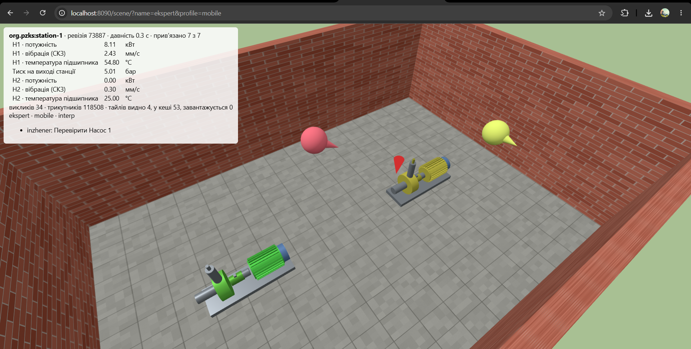

# Спільне багатокористувацьке середовище

## Спільний стан

Кілька учасників — оператор-диспетчер, інженер з обслуговування, віддалений експерт — разом оглядають 3D-сцену станції: бачать аватари одне одного й лишають позначки на обладнанні («перевірити підшипник Н1»). У сцені **два джерела істини**: платформа Eclipse Ditto відповідає за **фізичний** стан станції, сервер сеансу (`session/server.js`) — за **віртуальний** стан спільної сцени, і жоден із них не володіє даними іншого.

| Складник | Як змінюється | Чи можна пропустити оновлення | Джерело істини |
|---|---|---|---|
| Поза аватара учасника (положення й орієнтація камери) | безперервно, учасник надсилає 20 разів за секунду | так — наступна поза повністю замінює попередню | **учасник**; сервер лише перевіряє межі території й пересилає |
| Позначки на обладнанні | подіями: поставити, видалити | **ні** — кожна зміна має дійти до всіх учасників | **сервер сеансу** (авторитетно): перевіряє, нумерує, видаляти дозволяє лише автору; новому учасникові надсилає повний перелік |
| Склад учасників сеансу | подіями: приєднання, від’єднання | ні | **сервер сеансу** |
| Стан двійника станції (тиски, вібрація, потужність, стани насосів) | щосекунди, з телеметрією | так — кожна подія несе повний поточний стан | **платформа Ditto**; кожен клієнт отримує його сам потоком SSE (крок 2), сервер сеансу його **не пересилає** |
| Геометрія (моделі glTF, тайли рельєфу) | рідко, разом з новою версією набору даних | — | **вебсервер `web`**: статичні файли, версія — у шляху (`tiles/site/v1`) |
| Вид, рівень деталізації, параметри подання | локально, у кожного свій | — | **клієнт**; не є спільним станом |

**Чому сервер сеансу не пересилає стан двійника.** Стан двійника вже має джерело істини — платформу, яка перевіряє його за моделлю WoT і нумерує ревізіями. Якби сервер сеансу пересилав його, з’явилася б друга копія фізичного стану з власною затримкою й можливими розбіжностями, а сервер сеансу ставав би посередником з телеметрією без права й засобів її перевіряти. Крім того, стан двійника не залежить від того, хто в сеансі: кожен клієнт і так отримує той самий стан з того самого джерела.

## Сценарій

**Розбір тривоги вібрації на насосі Н1.** Двійник показує, що вібрація Н1 повільно зростає (корпус насоса в 3D-сцені змінює колір від зеленого до жовтого). Оператор-диспетчер скликає спільний сеанс у 3D-сцені станції:

| Учасник | Мережа | Що робить | Який складник спільного стану змінює |
|---|---|---|---|
| Оператор-диспетчер | диспетчерська водоканалу (локальна мережа) | відкриває сцену, підходить камерою до Н1, ставить позначку «Вібрація Н1 росте» | свою позу аватара; позначку (створює) |
| Інженер з обслуговування (`inzhener`) | виїзд, міська широкосмугова мережа (`city`) | оглядає Н1 зблизька, ставить позначку «Перевірити підшипник Н1» на підшипниковому вузлі, після огляду видаляє свою позначку | свою позу; позначки (створює й видаляє — лише власні) |
| Віддалений експерт виробника насоса (`ekspert`) | мобільна мережа (`mobile`) | стежить, куди дивляться інші, порівнює стан Н1 і резервного Н2, радить, коли перемикати насоси | свою позу |
| Бот (`bot`) | локальна мережа | обходить зал відомою траєкторією — тестовий учасник для вимірювань кроку 11 | свою позу |

Стан двійника (кольори обладнання й значення на панелі) жоден учасник не змінює: кожен клієнт отримує його від платформи. Рішення про зупинку Н1 оператор ухвалює поза сценою — через команди двійника (ЛР 1, FR-08), а не через сервер сеансу.

**Перевірка.** У двох вікнах браузера (`?name=inzhener&profile=city&view=near` і `?name=ekspert&profile=mobile`) разом із ботом: в обох вікнах бот обходить зал і щодесять секунд зупиняється; кожен учасник бачить аватар іншого (кулька з «носом» у напрямку погляду), що рухається й повертається разом з його камерою. Позначка, поставлена інженером подвійним клацанням біля Н1, за частку секунди з’являється в експерта; «×» для видалення є лише в автора.

**Вихідний потік сервера.** Сервер розсилає знімки N учасникам з частотою f = 20 Гц, і в кожному знімку K = N − 1 аватарів (без власного). Розрахунок за лекцією 11 — R_с = 8 · N · K · f · s; з урахуванням службової частини знімка (тип, мітка часу) s₀ — R_с = 8 · N · f · (s₀ + K · s). Виміряно (термінал сервера, середнє за 5 с):

| Учасників N | K = N − 1 | Виміряно R_с, кбіт/с |
|---:|---:|---:|
| 1 (бот) | 0 | 5,9 |
| 2 (бот, інженер) | 1 | 43,1 |
| 3 (бот, інженер, експерт) | 2 | 121,3 |

З вимірів: службова частина знімка s₀ ≈ 37 байт, один аватар у JSON (ім’я, положення — 3 числа, орієнтація — 4 числа) s ≈ 100 байт (98–108 байт залежно від довжини чисел). Підставивши s₀ = 37 і s = 103 байти у вираз, отримуємо 5,9 / 45 / 117 кбіт/с — розрахунок відрізняється від виміряного не більш ніж на 4 %. Потік росте **квадратично** за кількістю учасників (N · K ≈ N²): для 10 учасників — ≈ 1,5 Мбіт/с, для 20 — ≈ 6,4 Мбіт/с. Для сеансу розбору аварії (3–5 учасників, ≤ 0,3 Мбіт/с) це не обмеження; для великих сеансів знадобилися б бінарний формат, дельта-кодування або зменшення частоти знімків для далеких аватарів.

## Профілі мережі

Затримки моделює сервер сеансу (функція `link`), профіль обирає клієнт. Спостерігач (`?name=obs&profile=…&measure=60`) показує бота в момент t − D_інт з D_інт за виразом (5), положення інтерполює лінійно, орієнтацію — сферично; режим `mode=extrap` замість інтерполяції продовжує останній рух (не довше 250 мс). Траєкторія бота відома клієнту, тож у кожному кадрі він визначає затримку показу τ і відхилення показу від траєкторії. Кожен прогін — 60 с, ≈ 8 600 кадрів; результати — `results/net-<профіль>-<режим>.json`.

Розрахунок за виразом (6): L_АБ = L↑ + t_оч + L↓ + D_інт, де бот працює в локальній мережі (L↑ ≈ 1 мс), спостерігач — у профілі прогону (L↓ = RTT/2 моделі), t_оч = T_зн/2 = 25 мс; для екстраполяції D_інт = 0.

| Профіль, режим | RTT, мс: модель / вимір | D_інт за (5), мс | L_АБ за (6), мс | Затримка p50 / p95, мс | Без новішого знімка, % | Відхилення, макс., см |
|---|---:|---:|---:|---:|---:|---:|
| Локальна мережа, інтерполяція | 2 / 21 | 51 | 78 | 100 / 124 | 35,5 | 0,2 |
| Міська, інтерполяція | 20 / 39 | 105 | 141 | 164 / 180 | 0 | 0,2 |
| Мобільна, інтерполяція | 60 / 111 | 130 | 186 | 208 / 224 | 0,6 | 0,2 |
| Мобільна, екстраполяція | 60 / 111 | — | 56 | 74 / 100 | — | 12,9 |

**Систематичний зсув ≈ 20 мс.** Виміряна медіана затримки в усіх чотирьох прогонах більша за розрахунок на 18–23 мс — майже однакову величину, тобто структура виразу (6) підтверджується, а різниця — стала добавка. Її причина видна з RTT: у локальній мережі модель дає 2 мс, а виміряно 21 мс. Сервер сеансу працює на Windows, де таймери Node.js (`setTimeout`, `setInterval`) мають роздільність системного таймера ≈ 15,6 мс: кожна змодельована затримка в кілька мілісекунд фактично триває до ~15 мс. Для показу бота це дві такі ділянки (бот → сервер і сервер → спостерігач), що й дає ≈ 20 мс понад модель.

**Локальна мережа: 35,5 % кадрів без новішого знімка.** Для профілю lan вираз (5) з m = 0 і джитером 1 мс дає D_інт = 51 мс — запас лише 1 мс понад період знімків. Але через ту саму роздільність таймерів фактичний розкид надходження знімків становить ≈ 15 мс, а не 1 мс, тож у третині кадрів наступний знімок ще не надійшов, і аватар на мить зупиняється. Висновок: джитер у виразі (5) треба брати виміряний, а не номінальний; з m = 1 (D_інт ≈ 101 мс) або з джитером 16 мс зупинки зникли б — так само, як вони зникли в профілях city і mobile, де m = 1.

**Інтерполяція проти екстраполяції.** Інтерполяція не відходить від траєкторії (найбільше відхилення — 2 мм у всіх профілях), але за мобільної мережі показує бота з затримкою 208 мс. Екстраполяція скорочує затримку майже втричі (74 мс), але на різкій зупинці бота аватар проскакує вперед на |Δv| · τ ≈ 1,5 м/с · 0,086 с ≈ 13 см — саме це й показав прогін (12,9 см). Показник «без новішого знімка» для екстраполяції не має сенсу: вона за визначенням завжди показує момент, новіший за останній знімок (у звіті — 100 %).

## Архітектурні обмеження

1. **Яку взаємодію допускає кожен профіль.** За локальної й міської мережі інші учасники видні із затримкою до 124 і 180 мс (p95): комфортні спільний огляд, вказування на обладнання й позначки. За мобільної мережі — 224 мс з інтерполяцією: досить для спільного огляду й позначок, але не для щільно скоординованих дій (наприклад, одночасного вибору одного елемента двома учасниками). Екстраполяція (100 мс) не розв’язує проблему, бо дає відхилення до 13 см на зупинках. Для спільного розбору тривоги на станції всі три профілі прийнятні.
2. **WebSocket (TCP) для поз проти невпорядкованого каналу.** WebSocket працює поверх TCP: втрачений сегмент затримує **всі** наступні повідомлення ще на один RTT, хоча кожна поза однаково замінює попередню. За мобільного профілю (2 % втрат, RTT 60 мс) це додаткові 60 мс у 2 % повідомлень. Невпорядкований ненадійний канал даних WebRTC (`ordered: false, maxRetransmits: 0`) просто відкинув би застарілу позу. Позначки ж мають доходити всі й по порядку, тож для них WebSocket — правильний вибір. Поки втрати й затримки в межах виміряних, один канал WebSocket простіший і достатній.
3. **Потік сервера росте як O(N²).** Виміряно 5,9 / 43,1 / 121 кбіт/с для 1 / 2 / 3 учасників (розділ «Сценарій»); за розрахунком — ≈ 1,5 Мбіт/с для 10 і ≈ 6,4 Мбіт/с для 20 учасників. Для сеансу розбору аварії (3–5 учасників, до ≈ 0,4 Мбіт/с) обмеження немає; понад ≈ 10 учасників потрібне керування зацікавленістю (надсилати учасникові лише аватари з його зони залу чи на певній відстані, далекі — з меншою частотою) і компактніший формат знімків.
4. **Відмова сервера сеансу.** Сервер — єдине джерело істини віртуального стану: якщо він зупиниться, зникнуть аватари, а позначки, які зберігаються лише в його пам’яті, буде втрачено. Стан двійника при цьому не постраждає: кожен клієнт отримує його від платформи напряму (SSE), тож 3D-подання станції працює й без сервера сеансу, лише без спільного режиму. Для продуктивного використання позначки треба зберігати в постійному сховищі, а клієнт — автоматично під’єднуватися знову й отримувати повний стан (сервер уже надсилає повний перелік позначок кожному новому учасникові).
5. **Команди фізичному об’єкту — не цим каналом.** Канал сеансу не перевіряє **права** (учасника визначає лише параметр `name`), не забезпечує **виключності** (двоє учасників можуть одночасно надіслати суперечливі команди), не гарантує **актуальності** (повідомлення доходять із затримкою 100–220 мс, а позначки можуть стосуватися вже зміненого стану) і не має **підтвердження** виконання. Тому команди насосам (уставка, пуск/зупинка, режим) ідуть лише через платформу: з політикою доступу й журналом (NFR-05), з підтвердженням reported = desired (FR-08) і обмеженнями в ПЛК (ADR-0002). Рішення про синхронізацію спільної сцени — `docs/adr/0005-synkhronizatsiia-stseny.md`.