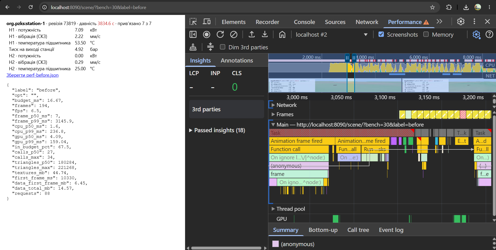

# Продуктивність 3D-подання

## Бюджет

**Найслабший цільовий пристрій** — ноутбук оператора-диспетчера з інтегрованою графікою й екраном 60 Гц (основний користувач 3D-подання за ЛР 1). Слабший центральний процесор моделюється уповільненням ЦП у 6 разів в інструментах розробника Chromium; слабший графічний процесор так змоделювати не можна, тож час ГП вимірюється на комп’ютері, де виконано прогони (модель зазначено в розділі «Профілювання»). Роздільна здатність рендерингу під час вимірювань фіксована — 1920 × 1080.

Значення з позначкою «модельне» обґрунтовано розрахунком, а не вимірюванням.

| Показник | Ціль | Підстава | Поле результату |
|---|---|---|---|
| Частка кадрів у бюджеті | ≥ 99 % кадрів з max(T_ЦП, T_ГП) ≤ 16,7 мс | екран ноутбука диспетчера 60 Гц: T_кадру = 1000 / 60 = 16,7 мс; за виразом (3) період кадру визначає більший із часів ЦП і ГП. Ціль удвічі суворіша за NFR-06 з ЛР 1 (99 % кадрів ≤ 33,3 мс), щоб мати запас на слабший пристрій | `in_budget_pct` |
| Виклики рисування за кадр | ≤ 50 | модельне: за виразом (4) N ≤ (16,7 − 6) / 0,2 ≈ 53 при T_лог = 6 мс (оновлення сцени, тайлів, обробка подій двійника) і t_викл = 0,2 мс на уповільненому ЦП | `calls_max` |
| Трикутники за кадр | ≤ 300 тис. | модельне: пропускна здатність інтегрованої графіки ноутбука з запасом на кадр 16,7 мс | `triangles_max` |
| Пам’ять текстур | ≤ 16 МБ | модельне: частка відеопам’яті, яку браузер дає вкладці на інтегрованій графіці (пам’ять спільна з ЦП) | `textures_mb` |
| Дані до першого кадру | ≤ 1,9 МБ | модельне: інженер з обслуговування відкриває сцену на виїзді з мобільним підключенням 5 Мбіт/с; перший кадр має з’явитися за 3 с: 5 Мбіт/с · 3 с / 8 ≈ 1,9 МБ | `data_first_frame_mb` |

## Профілювання

**Пристрій вимірювань:** ноутбук HP Pavilion Gaming 15-ec1xxx, AMD Ryzen 7 4800H. Chrome рисує сцену на **вбудованій графіці AMD Radeon** процесора (`GL_RENDERER: ANGLE (AMD, AMD Radeon(TM) Graphics, Direct3D11)`), а не на дискретній GTX 1660 Ti Max-Q, тож час ГП виміряно саме на інтегрованій графіці — того самого класу, що й цільовий ноутбук диспетчера.

**Умови:** модуль `scene/bench.js` (`?bench=30&label=before`), 3 с прогріву і 30 с однакового обльоту станції з відстані 8–308 м, рендеринг 1920 × 1080, у DevTools уповільнення ЦП у 6 разів і вимкнений кеш (Network → Disable cache). Результат — `results/perf-before.json`.

| Показник | Ціль | До оптимізацій | |
|---|---|---:|---|
| Частка кадрів у бюджеті 16,7 мс | ≥ 99 % | 67,5 % | ✗ |
| Період кадру p50 / p99, мс | — | 7 / 3146 | |
| T_ЦП p50 / p99, мс | — | 1,6 / 236,8 | |
| T_ГП p50 / p99, мс | — | 4,09 / 159,04 | |
| Кадрів за 30 с (fps) | — | 194 (6,5) | |
| Виклики рисування, макс. | ≤ 50 | 34 | ✓ |
| Трикутники, макс. | ≤ 300 тис. | 221 268 | ✓ |
| Пам’ять текстур | ≤ 16 МБ | 44,74 МБ | ✗ |
| Дані до першого кадру | ≤ 1,9 МБ | 6,45 МБ | ✗ |
| Час до першого кадру | — | 10,3 с | |
| Усього завантажено | — | 14,57 МБ, 88 запитів | |

**Що обмежує сцену.** У звичайному кадрі сцена легка: медіана T_ЦП — 1,6 мс, T_ГП — 4,1 мс, обидва значення набагато менші за бюджет 16,7 мс; ГП працює над кадром довше за ЦП. Проблема — не середній кадр, а **рідкісні дуже довгі**: 99-й процентиль періоду кадру — 3,1 с, через що за 30 с показано лише 194 кадри, а в бюджет вклалося 67,5 %. На панелі Performance це довгі задачі головного потоку (позначені червоним) і великі блоки на доріжці GPU: розбір щойно завантажених файлів glTF (тайли рельєфу, моделі), декодування текстур PNG і їх передавання у відеопам’ять. Тобто сцену обмежує **не рисування, а завантаження й підготовка даних** на уповільненому ЦП, а також обсяг даних, які треба отримати й розпакувати.

**Найбільші запити** (Network, сортування за розміром переданих даних):

| Запит | Розмір | Що це |
|---|---:|---|
| `models/hall.glb` | 4 278 кБ | зал: дві текстури PNG 2048 × 2048 |
| `models/pump-unit.glb` | 1 394 кБ | детальна модель агрегату (41 784 трикутники) |
| `three.core.js` | 378 кБ | бібліотека three.js (стиснена gzip) |
| `three.module.js` | 166 кБ | бібліотека three.js (стиснена gzip) |
| тайли рельєфу `*.glb` | 118 кБ кожен | 341 тайл, завантажуються в міру потреби |

Дві моделі разом — 5,7 МБ з 6,45 МБ до першого кадру.

**Вузькі місця:**

| Показник | Причина | Оптимізація, що на нього діє |
|---|---|---|
| Пам’ять текстур: 44,7 МБ при цілі 16 МБ | дві текстури залу 2048 × 2048 зберігаються у відеопам’яті нестисненими (RGBA, 4 байти на піксель + міпмапи) | **стиснення текстур KTX2** (`ktx2`): блоковий формат займає у відеопам’яті в рази менше |
| Дані до першого кадру: 6,45 МБ при цілі 1,9 МБ | до першого кадру завантажуються зал з текстурами PNG (4,3 МБ) і детальна модель агрегату (1,4 МБ) | **KTX2** (зменшує `hall.glb`), **відкладене завантаження** (`defer`: першим показується спрощений агрегат, детальна модель і тайли — після першого кадру), **спрощення геометрії** (`simp`: менша детальна модель) |
| Частка кадрів у бюджеті: 67,5 % при цілі 99 % | довгі задачі розбору й передавання даних у відеопам’ять (p99 T_ЦП — 237 мс, T_ГП — 159 мс) | **KTX2** (немає декодування PNG і менше даних у відеопам’ять), **спрощення** (менше вершин для розбору й передавання), **відкладене завантаження** (рознесення завантажень у часі) |
| Виклики (34) і трикутники (221 тис.) | у межах бюджету | — (спрощення додатково зменшить трикутники близько до камери) |