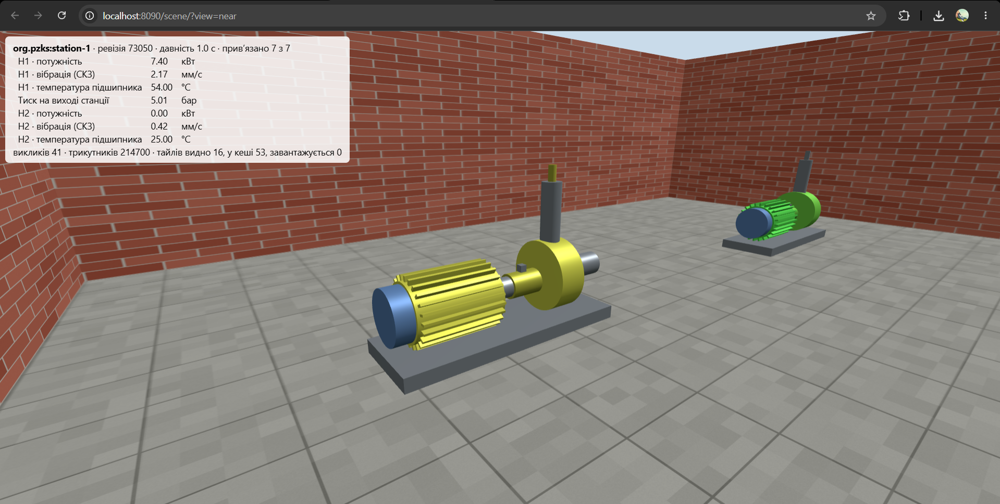

# 3D-сцена двійника

## Модель і ідентифікатори

**Джерело моделі.** Власна модель, складена з примітивів three.js сценарієм `scene/tools/make-model.mjs` і записана бібліотекою glTF Transform у формат glTF 2.0 (`.glb`). Сторонніх моделей не використано, тож обмежень ліцензії немає. Розміри — у метрах, вісь Y — угору.

| Файл | Що містить | Елементів | Трикутників | Розмір |
|---|---|---:|---:|---:|
| `models/pump-unit.glb` | насосний агрегат, детальний рівень (LOD0): 192 сегменти на коло | 10 | 41 784 | 1,4 МБ |
| `models/pump-unit-lod1.glb` | той самий агрегат, спрощений рівень (LOD1): `gltfpack -si 0.1 -kn -ke` | 10 | 4 194 | 78 КБ |
| `models/hall.glb` | машинний зал станції 12 × 8 × 3,5 м: підлога й чотири стіни, дві текстури PNG 2048 × 2048 | 5 | 60 | 4,3 МБ |

Спрощений рівень містить 10 % трикутників детального, а ідентифікатори всіх 10 елементів збереглися (перевірка `node tools/elements.mjs models/*.glb`). Зал має лише 60 трикутників, але займає найбільше місця через дві великі текстури — це навмисне вузьке місце для оптимізації на занятті 2.

Кожна деталь агрегату — окремий вузол glTF з ім’ям і властивістю `extras.element`, значення якої — ідентифікатор елемента. Сцена містить два агрегати — Н1 і Н2 (`pump-1`, `pump-2`), обидва з однієї моделі.

| Ідентифікатор | Деталь | Сигнал двійника `org.pzks:station-1` |
|---|---|---|
| `frame` | рама | — |
| `motor` | електродвигун | `pump1/power`, `pump2/power` — електрична потужність (S-08, S-09) |
| `fan` | вентилятор двигуна | — |
| `coupling` | муфта | — |
| `bearing` | підшипниковий вузол | `pump1/bearingTemperature`, `pump2/bearingTemperature` — температура підшипника (S-10, S-11) |
| `pump` | корпус насоса | `pump1/vibration`, `pump2/vibration` — вібрація, СКЗ (S-01, S-02) |
| `inlet` | вхідний патрубок | — |
| `outlet` | напірний патрубок | — |
| `sensor-p` | датчик тиску | `station/outletPressure` — тиск на виході станції (S-04), лише на Н1 |
| `sensor-v` | віброперетворювач | — (його сигнал показує корпус насоса) |

## Прив’язка телеметрії

Сцену віддає вебсервер `web` з ЛР 2 (http://localhost:8090/scene/), тож API Ditto доступне з того самого джерела (`/api/`) і лише для читання. Стан двійника сцена отримує так само, як вебподання ЛР 2: початковий — запитом до API, зміни — потоком подій SSE (`scene/twin.js`).

Ланцюжок «вузол glTF → `extras.element` → `binding.json` → властивість двійника»:

1. **Вузол glTF.** Кожна деталь агрегату — іменований вузол моделі з `extras.element`, наприклад `{"name": "motor", "extras": {"element": "motor"}}`. GLTFLoader переносить `extras` у `userData` об’єкта three.js.
2. **`extras.element` → елемент сцени.** Після `gltfpack` сітка може опинитися в безіменному дочірньому вузлі, тому функція `elementOf` (`scene/station.js`) шукає ідентифікатор у найближчого предка сітки. Агрегат у сцені знаходиться за ім’ям об’єкта LOD (`pump-1`, `pump-2`).
3. **`binding.json`.** Таблиця прив’язки — дані, а не код: для кожного запису — агрегат (`asset`), ідентифікатор елемента (`node`), функціональний блок і властивість двійника (`feature`, `property`) і діапазон шкали кольору (`min` — зелений, `max` — червоний).
4. **Властивість двійника.** Кожна подія SSE несе стан двійника `org.pzks:station-1`; `twin.js` бере `features.<feature>.properties.<property>`, переводить значення в колір і викликає `station.paint(asset, node, колір)`.

Прив’язано 7 елементів:

| Агрегат | Елемент | Властивість двійника | Шкала кольору |
|---|---|---|---|
| Н1 (`pump-1`) | `motor` | `pump1/power` | 0–15 кВт |
| Н1 | `pump` | `pump1/vibration` | 0–4,5 мм/с (поріг тривоги) |
| Н1 | `bearing` | `pump1/bearingTemperature` | 20–90 °C |
| Н1 | `sensor-p` | `station/outletPressure` | 0–10 бар |
| Н2 (`pump-2`) | `motor` | `pump2/power` | 0–15 кВт |
| Н2 | `pump` | `pump2/vibration` | 0–4,5 мм/с |
| Н2 | `bearing` | `pump2/bearingTemperature` | 20–90 °C |

Обидва агрегати створено з однієї моделі (`clone()`), і їхні сітки ділять спільний матеріал. Тому `paint` один раз створює для елемента власну копію матеріалу: інакше зміна кольору двигуна Н1 перефарбувала б і двигун Н2.

На знімку — вид `?view=near`: робочий насос Н1 має «теплі» кольори (потужність ≈ 7 кВт, вібрація ≈ 2,2 мм/с), резервний Н2 — зелений (нульова потужність, фонова вібрація). Після зупинки емулятора давність даних стає червоною, а колір елементів лишається останнім відомим.
