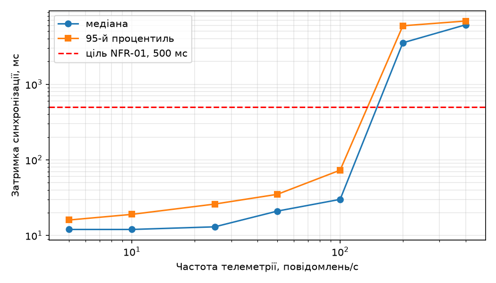

# Синхронізація стану й масштабованість

## Перевірка узгодженості

Перевірка `sync/consistency.py` порівнює те, що надіслало джерело (`results/source.csv`), з історією станів у InfluxDB (історик `sync/historian.py`) і з поточним станом двійника в Ditto. Для кожного з 300 повідомлень порівнюються всі 16 сигналів. Сеанс: `python emulator/emulator.py --rate 10 --count 300`, потім `python sync/consistency.py`.

**Прогін 1 — навмисна помилка у відображенні.** У `platform/mapping.js` поміняно місцями тиск на вході й витрату (`inletPressure: m.q`, `flow: m.pi`):

| Перевірка | Результат |
|---|---|
| Надіслано джерелом | 300 |
| Є в історії двійника | 0 (0.0%) |
| Втрачено (номери) | 300 [1, 2, 3, 4, 5, 6, 7, 8, 9, 10] |
| Розбіжність значень | 0 |
| Позачергові оновлення | 0 |
| Пропущені ревізії (не дійшли до історика) | 0 |
| Кінцевий стан = останній відлік | НІ |
| Затримка синхронізації p50 / p95, мс | немає даних |

Витрата 20–70 м³/год не вміщується в діапазон тиску 0–10 бар з моделі TM, тож Ditto відхилив **усі** оновлення: перевірка показала 100 % втрат, а двійник зберіг останній валідний стан, тому кінцевий стан не збігся з останнім відліком. Помилку відображення зупинила **модель двійника** — перший рубіж перевірки, ще до того як некоректні дані потрапили у стан. Після цього відображення повернуто (`git checkout platform/mapping.js`, `python platform/connection.py`).

**Прогін 2 — нормальна робота** (`results/consistency.md`):

| Перевірка | Результат |
|---|---|
| Надіслано джерелом | 300 |
| Є в історії двійника | 300 (100.0%) |
| Втрачено (номери) | 0 [] |
| Розбіжність значень | 0 |
| Позачергові оновлення | 0 |
| Пропущені ревізії (не дійшли до історика) | 0 |
| Кінцевий стан = останній відлік | так |
| Затримка синхронізації p50 / p95, мс | 20 / 27 (ціль ≤ 500: виконано) |

Стан двійника повністю узгоджений з джерелом: усі 300 повідомлень дійшли, значення всіх 16 сигналів збігаються, оновлення застосовано в порядку надсилання, пропусків ревізій немає. **NFR-01 виконано:** 95-й процентиль затримки синхронізації — 27 мс за ціллю 500 мс. Оцінка ділянок платформи в моделі ЛР 1 (≈ 95 мс для конфігурації Г-01) виявилася консервативною: стенд працює на одному комп’ютері, без TLS і VPN між станцією та ЦОД.

## Навантажувальне тестування

Сценарій `load/locustfile.py`: кожен користувач Locust — шлюз, що публікує 5 повідомлень/с у тему двійника `org.pzks:station-1`; кількість шлюзів зростає ступенями 1, 2, 5, 10, 20, 40, 80 по 60 с, тобто частота — від 5 до 400 повідомлень/с **на один двійник**. Історик працював увесь прогін. Locust надіслав 46 789 повідомлень без жодного збою публікації (`0(0.00%)`, звіт `results/locust.html`). Аналіз `load/analyze.py` зіставив надіслане (`results/sent.csv`) з історією станів у InfluxDB (`results/load.csv`):

| Частота, повідомл./с | Фактична | Надіслано | Отримано | Втрати ε, % | p50, мс | p95, мс | NFR-01 (p95 ≤ 500 мс) |
|---:|---:|---:|---:|---:|---:|---:|---|
| 5 | 5 | 293 | 293 | 0 | 12 | 16 | виконано |
| 10 | 10 | 597 | 597 | 0 | 12 | 19 | виконано |
| 25 | 25 | 1461 | 1461 | 0 | 13 | 26 | виконано |
| 50 | 49 | 2975 | 2975 | 0 | 21 | 35 | виконано |
| 100 | 99 | 5830 | 5830 | 0 | 30 | 73 | виконано |
| 200 | 197 | 11 857 | 11 618 | 2,02 | 3528 | 5922 | **не виконано** |
| 400 | 394 | 23 689 | 10 192 | 56,98 | 6099 | 6843 | **не виконано** |

Пропущених ревізій — 0: усі оновлення, які платформа застосувала, історик отримав. Отже втрати на ступенях 200 і 400 повідомлень/с належать не шляху спостереження, а самій платформі: ці повідомлення так і не стали оновленнями стану двійника. Фактична частота на всіх ступенях збігається із заданою, тож межі досягла платформа, а не генератор навантаження.

## Висновок щодо масштабованості

**1. До якої частоти виконується NFR-01.** Ціль NFR-01 з ЛР 1 (p95 затримки синхронізації ≤ 500 мс) виконується **до 100 повідомлень/с на один двійник** (p95 = 73 мс). До 25 повідомлень/с затримка майже стала (p50 12–13 мс), між 25 і 100 повідомленнями/с починає повільно зростати. Між 100 і 200 повідомленнями/с — «коліно»: на 200 повідомленнях/с медіана стрибає до 3,5 с, а на 400 повідомленнях/с втрачається більше половини повідомлень. Станція надсилає 1 повідомлення/с, тож запас — приблизно в 100 разів.

**2. Що обмежує пропускну здатність (формула 5).** Модель масового обслуговування `W = 1 / (μ − λ)` пояснює форму графіка. Поки інтенсивність надходження λ далека від інтенсивності обслуговування μ, затримка майже стала. Коли λ наближається до μ, черга росте, а при λ > μ — росте без меж: затримка вимірюється секундами, а повідомлення, що не вміщуються в буфери, відкидаються. Оновлення одного двійника Ditto обробляє **послідовно** (кожне застосовується й зберігається по черзі), тож μ — це пропускна здатність обробки одного двійника. За графіком вона лежить **між 100 і 200 повідомленнями/с**. Найімовірніше місце відкидання при перевантаженні — черги непідтверджених повідомлень QoS 1 між брокером і з’єднанням Ditto: брокер обмежує їхню кількість і нові повідомлення понад ліміт відкидає.

**3. Як масштабувати платформу.**
- **Більше об’єктів.** Кожна станція — окремий двійник з власною чергою обробки, а кластер Ditto розподіляє різні двійники між вузлами (горизонтальне масштабування). Вимога NFR-03 з ЛР 1 — 10 станцій по ≈ 27 повідомлень/с — означає ≈ 27 повідомлень/с на **кожен** двійник, що далеко в межах виміряних 100 повідомлень/с. Цей тест навантажував **один** двійник частотою до 400 повідомлень/с, тобто був жорсткішим за NFR-03; прямий тест «10 двійників з тією ж сумарною частотою» — кандидат для ЛР 4. Брокер і сховище масштабуються окремо: кластер MQTT-брокерів, кошики InfluxDB.
- **Вища частота одного об’єкта.** Двійник має зберігати стан, а не сирий потік. Швидкі сигнали треба агрегувати на периферії (як СКЗ вібрації в ADR-0003) і передавати одне оновлення стану на секунду; за потреби — об’єднувати кілька відліків в одне оновлення або розділити станцію на кілька двійників (наприклад, окремо для кожного насоса), щоб їхні оновлення оброблялися паралельно. Сирі високочастотні дані краще писати в сховище часових рядів безпосередньо з брокера, в обхід двійника.
