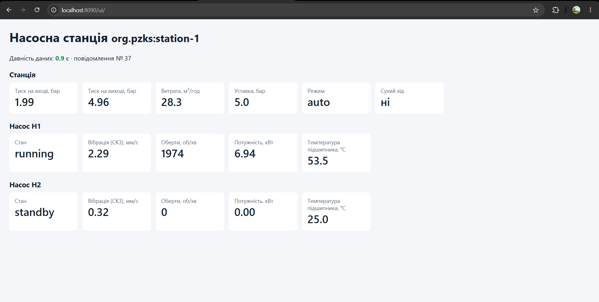

# Канал телеметрії

## Схема повідомлення

Емулятор `emulator/emulator.py` відтворює шлюз станції: щосекунди публікує одне повідомлення JSON з поточними значеннями всіх сигналів у **форматі пристрою** — з короткими назвами полів, як у реальних шлюзах. Перетворення на модель двійника виконує не емулятор, а з’єднання Ditto (крок 11), тож заміна датчика чи шлюза змінить лише відображення.

- **Тема:** `pzks/<ім’я двійника>/telemetry`, для станції — `pzks/station-1/telemetry`
- **QoS:** 1 (щонайменше один раз)
- **Частота:** 1 повідомлення/с (параметр `--rate`)
- **Кодування:** UTF-8, JSON

Приклад повідомлення (перше повідомлення реального прогону `python emulator/emulator.py --rate 1 --count 5`):

```json
{"seq": 1, "ts": 1794679034420, "pi": 2.098, "po": 5.046, "q": 26.12, "sp": 5.0,
 "mode": "auto", "dry": false,
 "v1": 2.248, "n1": 1963, "w1": 6.89, "t1": 53.6, "s1": "running",
 "v2": 0.284, "n2": 0, "w2": 0.0, "t2": 25.0, "s2": "standby"}
```

Опис полів (за IEEE 2888.1 для кожного поля вказано величину, одиницю, тип, діапазон і точність подання):

| Поле | Величина | ID реєстру | Одиниця | Тип | Діапазон | Точність |
|---|---|---|---|---|---|---|
| `seq` | номер повідомлення | — | — | integer | ≥ 1, зростає на 1 | 1 |
| `ts` | час відліку на шлюзі | — | мс від 1970-01-01 UTC | integer | ≥ 0 | 1 мс |
| `pi` | тиск на вході | S-03 | бар | number | 0–10 | 0,001 |
| `po` | тиск на виході | S-04 | бар | number | 0–10 | 0,001 |
| `q` | витрата води | S-05 | м³/год | number | 0–120 | 0,01 |
| `sp` | фактична уставка тиску | S-16 | бар | number | 4,0–6,0 | 0,1 |
| `mode` | режим станції | S-15 | — | string | `auto`, `night`, `service`, `emergency` | — |
| `dry` | сухий хід | S-14 | — | boolean | `true` / `false` | — |
| `v1`, `v2` | вібрація Н1 / Н2 (максимум СКЗ за 1 с) | S-01, S-02 | мм/с | number | 0–20 | 0,001 |
| `n1`, `n2` | частота обертання Н1 / Н2 | S-06, S-07 | об/хв | integer | 0–3000 | 1 |
| `w1`, `w2` | електрична потужність Н1 / Н2 | S-08, S-09 | кВт | number | 0–15 | 0,01 |
| `t1`, `t2` | температура підшипника Н1 / Н2 | S-10, S-11 | °C | number | 0–120 | 0,1 |
| `s1`, `s2` | стан Н1 / Н2 | S-12, S-13 | — | string | `running`, `standby`, `stopped`, `fault` | — |

Діапазони збігаються з реєстром сигналів ЛР 1 і з моделями TM: значення поза ними Ditto відхилить.

**Що відтворює емулятор:** Н1 працює, Н2 у резерві. Розбір води повільно змінюється з періодом 10 хв, і разом з ним змінюються витрата, тиск на вході, оберти й потужність Н1; тиск на виході тримається біля уставки 5 бар (його регулює ПЛК). Температура підшипника оновлюється раз на 10 с, як у реєстрі (0,1 Гц). Кожне повідомлення дублюється в `results/source.csv` — це «істина джерела» для перевірки узгодженості на занятті 4.

## Приймання телеметрії платформою

Перетворення формату пристрою на модель двійника виконує з’єднання Ditto `mqtt-telemetry` (домен DCE): `platform/connection.json` підписується на теми `pzks/+/telemetry` з QoS 1 від імені суб’єкта `integration:telemetry`, а відображення `platform/mapping.js` перекладає короткі поля (`pi`, `v1`, `s2`…) на властивості функціональних блоків і формує команду `merge`. Ditto отримує телеметрію напряму з брокера, без проміжного сервісу — це конфігурація гіпотези Г-01 з ЛР 1.

Перевірка (`python platform/connection.py`, потім `python emulator/emulator.py --rate 1 --count 10`):

```
201 {"id":"mqtt-telemetry","name":"mqtt-telemetry","connectionType":"mqtt","connectionStatus":"open", ...}
Стан з’єднання: open
```

Стан двійника після 10 повідомлень — властивості оновилися, `seq` дорівнює номеру останнього повідомлення:

```json
{"station":{"properties":{"inletPressure":2.077,"outletPressure":4.947,"flow":25.47,
            "dryRun":false,"mode":"auto","setpoint":5}},
 "pump1":{"properties":{"vibration":2.321,"speed":1983,"power":6.98,
          "bearingTemperature":53.8,"state":"running"}},
 "pump2":{"properties":{"vibration":0.311,"speed":0,"power":0,
          "bearingTemperature":25,"state":"standby"}},
 "sync":{"properties":{"seq":10,"ts":1794680205601}}}
```

## Вебподання

Вебподання `ui/index.html` (http://localhost:8090/ui/) отримує початковий стан двійника запитом до API, а зміни — потоком подій SSE через проксі `web`, який дозволяє лише читання.



Подання реалізує три рішення з лекції 2:

1. **Кеш останнього відомого стану.** Функція `apply` записує на сторінку лише ті властивості, що прийшли в події, а решта значень лишається попередньою. Якщо телеметрія зникне, оператор і далі бачить останні відомі значення, а не порожні поля.
2. **Явна давність даних.** Подання рахує, скільки часу минуло від мітки часу відліку на джерелі (`sync.ts`), і фарбує її: до 2 с — зелений, до 10 с — жовтий, понад 10 с — червоний. Оператор одразу бачить, що значення застаріли (FR-03 з ЛР 1).
3. **Власна частота оновлення.** Давність перераховується таймером 4 рази на секунду незалежно від того, як часто надходить телеметрія. Мережа не входить у цикл оновлення подання: якщо події затримуються, сторінка не «зависає», а показує, що дані старішають.